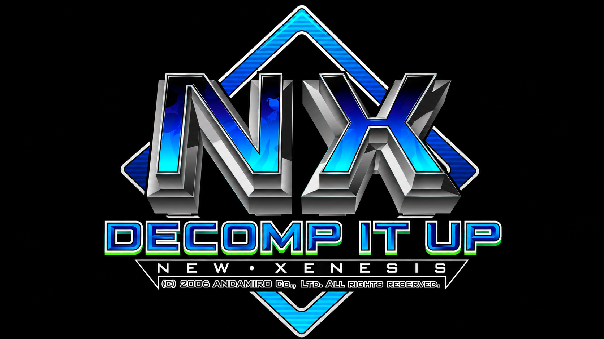

# NXReconstructed (Decomp-it-up-New-Xenesis)

A faithful C reconstruction of **Pump It Up NX (New Xenesis)**, based on the Linux arcade
executable `piu` (ELF i386).

This project reverse-engineers the original binary and reproduces its gameplay, rendering, audio,
and state machine as closely as possible — no emulation, no wrappers. Native executable for
Windows and Linux, built with SDL2 + OpenGL.

It continues the series **PumpyReconstructed** (PREX 3) → **ExceedReconstructed** →
**Exceed2Reconstructed** → **ZeroReconstructed**. Screens from earlier versions that were replaced
by their NX counterparts are kept in the tree, disabled (commented out or left out of the build).
See [docs/ZERO_PARA_NX.md](docs/ZERO_PARA_NX.md) for the Zero → NX differences.

Releases: <https://github.com/bmbelo87/decomp-it-up-New-Xenesis/releases> (Windows 64-bit, Windows
32-bit and Linux). The build name shown in the Service Menu and in `pumpy.log` is
`RECOMP-<version>`; the last number goes up by one with every commit.

## Status

| Feature                                                          | Status |
| ---------------------------------------------------------------- | ------ |
| Asset decryption: RESPAC2 (`.DAT`), MOV3 (`.MOV`), `.SEE` steps (STEE + Blowfish) | ✅ |
| Song table: 193 songs from `piu` (`0x0813c200`)                  | ✅      |
| Attract loop (CFlowControl): logo → NEXCADE → opening → title → demo play → ranking → WPF2007 | ✅ |
| Ranking screen (CHighScore, `HIGHSCORE.DAT`), top 20             | ✅      |
| Credit strip (CCreditManager, `CREDIT.DAT`): credits / FREE PLAY / EVENT / DEMO PLAY | ✅ |
| Station Select (CStation): TRAINING / ARCADE / WORLD TOUR / SPECIAL ZONE | ✅ |
| Default station from the Service Menu (EEPROM `+0xECA`)          | ✅      |
| Song select (CSelect): carousel, channels, preview, 1P/2P difficulties | ✅ |
| Song title / artist / BPM scrolling under the disc (`MICROGBE.TTF`) | ✅   |
| Modifier codes with `COMMAND.DAT` icons (two codes on the same slot alternate every 3 s) | ✅ |
| SPECIAL ZONE: channels by heart cost, hearts, extra stage        | ✅      |
| WORLD TOUR (CSelectWorld): map, regions, missions, commands, conditions | ✅ |
| WORLD TOUR: mission objective, items, Continue, WorldGrade, Mission Clear, unlocks | ✅ |
| WORLD TOUR: records and names per location (`SETTINGS/RANK.DAT`) | ✅      |
| TRAINING Station (CSelectEz): lessons / parts, lesson text, codes | ✅     |
| Gameplay: skins from `BGA\SKINxx.DAT`, row judgment, long notes   | ✅      |
| Gameplay: NX Mode (3D track), X Mode, AC/DC, UA, Vanish, Flash, …  | ✅      |
| Gameplay: per-player skin, step zone, speed changes and commands (P2 too, Double / Nightmare) | ✅ |
| Life bar: animation and rules per LEVEL option (EASY / NORMAL / HARD) | ✅   |
| Song backgrounds: `BGA\%03X.MOV` → `BGA\%03X.DAT` → `BGA\001.MOV` | ✅     |
| Stage Break (life by Service Menu option, 51 misses), `STAGEBREAK.MOV/.AUD` | ✅ |
| kcal screen at the end of the credit (CSports, `SPORTS.DAT`)     | ✅      |
| Enter Your Name with the name-change animation (`NCHANGE.DAT`)   | ✅      |
| Service Menu with the NX options (`SCRIPT\SETUP_*.LUA`)          | ✅      |
| GAME STYLE option (VANILLA / MODDED), see below                  | ✅ Port extra |
| Settings saved in `SETTINGS/PIUNX.INI` (EEPROM image)            | ✅      |
| Mercy ticket / score per ticket / credit limit                   | ⚙️ Saved, not used by the game yet |
| RESTRICTION page in the Service Menu (per-song on/off, `restrict.dat`) | ✅ Port extra |
| Internet Ranking                                                 | ❌ Turned off on purpose (code kept in `ir.c`) |

## Song Select Controls

| Pad | Action |
| --- | ------ |
| DL / DR | Previous / next song (held: repeat with acceleration) |
| UL / UR | Difficulty / channel |
| C | First press: READY. Second press: start |

The C that ends a modifier code belongs to the code and does not count as the first press. Pads
are only read once the screen has finished coming in.

## GAME STYLE (VANILLA / MODDED)

Service Menu → GAME OPTION. `VANILLA` (default) behaves like the arcade. `MODDED` turns on what
this port adds:

| What | In MODDED |
| ---- | --------- |
| Extra codes | Skins REbirth / EZ / SLIME / MELODY, 5X, 6X, +0.5X, BGA Off |
| Extra songs | **Fighting Spirit** and **Valenti** (K-POP channel) and **Fighting Spirit Another** (SPECIAL ZONE). The files are already in the NX data; only the arcade list leaves them out |
| Attract in FREE PLAY / EVENT | The attract loop runs instead of staying on the title; C goes to the title |
| Dance Grade | Three C presses to skip the screen (one in VANILLA) |
| GAME OPTION | Three more lines: UNLOCK SPECIAL ZONE, AUTOPLAY KEY (F8), DG TEST KEY (F12), all OFF by default |

## Modifiers (Commands)

Entered on the song select (and on the TRAINING lesson select) with the pads of the player they
apply to (check `0x804d240`, table `0x8143ca0`, effects `0x807c050` in `piu`).

Full list with arrow sprites, the GAME STYLE (VANILLA / MODDED) extras, operator keys and in-game
shortcuts: [docs/COMMANDS.md](docs/COMMANDS.md) (Portuguese).

| Sequence | Effect |
| -------- | ------ |
| `UL UR UL UR C` | Speed: 2X → 3X → 4X → 8X → off |
| `UL UR UL UR UL UR UL UR C` | RV (random velocity) |
| `DR DL UR UL DR UR DL UL C` | EW (earthworm) |
| `UL UR DL DR C` | Vanish → Non-Step → off |
| `DL UL DR DL UR DR UL UR C` | FL (flash) |
| `UL DL UR DR DR UL UR DL C` | FD (freedom) |
| `DR DL UR UL DR DL UR UL C` | M (mirror) |
| `UL UR UL UR DL DR DL DR C` | RS (random step) |
| `DL DL DR DR UL UL UR UR C` | AC (acceleration) |
| `DR DR DL DL UR UR UL UL C` | DC (deceleration) |
| `UL UR C DL DR DR DL C UR UL C` | RG (grade reverse) |
| `DL UR DL UR DR UL DR UL C` | X Mode (both players) |
| `DL UL C DR UR DL UL C DR UR` | NX Mode (both players) |
| `DL C DL C DL C UR C` | UA (track rotated 180°, both players) |
| `DR DR DR DL DR UL UR DL UR` / `C` / `UL` | Skin 1 / 2 / 7 |
| `UL UR DL C DL DR DR UR UR` | Skin 6 |
| `DL DR DL DR DL DR` | Reset |

Extras of this port (not in `piu`), only with GAME STYLE = MODDED:

| Sequence | Effect |
| -------- | ------ |
| `UL UL UL DL DL DL DR UL DL` | Skin 0 (REbirth) |
| `UL UR DL C DL DR DR UR DL` / `UL` / `DR` | Skin 3 (EZ) / 4 (SLIME) / 5 (MELODY), sequences from NX2 |
| `UL UR UL UR C` | The speed code becomes 2X → 3X → 4X → 5X → 6X → 8X → off |
| `UL UL UR UR C` | +0.5X added to the fixed speed (1.5X, 2.5X, …); not with RV or EW |
| `DL DL DL DL DR DR DR DR C` | BGA Off (star field instead of the song background) |

## Keys

| Key | Action |
| --- | ------ |
| F1 | Service Menu (TEST) |
| F2 | SERVICE (free credit) |
| F3 | COIN CLEAR: coins and credits back to zero |
| F4 / F5 | COIN1 / COIN2 |
| F8 (during a song) | Autoplay on/off. Needs MODDED and AUTOPLAY KEY on; an "AUTOPLAY" label is shown and `pumpy.log` records it |
| F12 (during a song) | Ends the song and shows the Dance Grade with fixed values. Needs MODDED and DG TEST KEY on |
| F11 | Debug overlay |
| ESC | Attract: next screen. During a credit: back to the logo, credit and codes reset. Service Menu: exit |
| Alt+Enter | Window / exclusive fullscreen |
| Alt+F4 | Quit |
| `` ` `` | Debug console (`/skin N`, `/drawfps`, `/play`, `/help`, …) |

## Project Structure

```
NXReconstructed/
├── src/
│   ├── main.c              # Entry point, state machine, game loop
│   ├── intro.c / logo.c    # Attract loop, movies, title, demo play
│   ├── highscore.c         # Ranking screen (CHighScore)
│   ├── nx_credit.c         # Credit strip (CCreditManager, CREDIT.DAT)
│   ├── coin.c              # Coins and credits
│   ├── nx_station.c        # Station Select (CStation)
│   ├── nx_select.c         # Song select (CSelect), SPECIAL ZONE, modifier codes
│   ├── nx_text.c           # Song title / artist text (stb_truetype)
│   ├── nx_world.c          # WORLD TOUR (CSelectWorld) + nx_world_data.c (generated)
│   ├── nx_mission.c        # Mission / lesson objective, Continue, Mission Clear
│   ├── nx_training.c       # TRAINING (CSelectEz) + nx_training_data.c (generated)
│   ├── nx_sports.c         # kcal screen (CSports)
│   ├── nx_rank.c           # SETTINGS/RANK.DAT (CRankManager)
│   ├── nx_songs.c          # Song table generated from piu (+ the MODDED extras)
│   ├── select_core.c       # Song wheel shared by the select screens
│   ├── gameplay.c          # Input, row judgment, long notes, items, NX/X mode, rendering
│   ├── result.c            # Dance Grade, WorldGrade and stage progression
│   ├── step.c              # .STX / .SEE step loading
│   ├── service_menu.c      # Service Menu (SETUP)
│   ├── game_option.c       # PUMPY.INI (port extras: audio offset, graphics, GAME STYLE)
│   ├── eeprom.c            # SETTINGS/PIUNX.INI (EEPROM image)
│   ├── movie.c             # MOV2/MOV3 playback (libmpeg2)
│   ├── resource.c / bga.c  # SPR/BGA/DAT/RESPAC2 loading, BGA3 scenes
│   └── ...                 # audio, input, render, texture, console, earlier games, etc.
├── include/                # Headers (pumpy.h = main game state, stb_truetype.h)
├── tools/
│   ├── zero_decrypt.py     # Extracts .AUD / .PNZ / .DAT / .MOV
│   ├── gen_nx_songs.py     # Song table generator (reads piu)
│   ├── gen_nx_world.py     # WORLD TOUR stages / missions / texts (reads piu)
│   ├── gen_nx_training.py  # TRAINING lessons / texts (reads piu)
│   ├── see_notes.py        # .SEE note histogram (Blowfish decode)
│   ├── piudis.py           # Disassembler helper for piu
│   ├── lua50_dump.py       # Lua 5.0 bytecode dumper for SCRIPT\*.LUA
│   └── recomp_version.cmake # Build version from the commit count
├── docs/                   # COMMANDS.md, ZERO_PARA_NX.md
└── CMakeLists.txt
```

## Building (Windows and Linux)

Window, input and audio use **SDL2**, rendering is **OpenGL 1.1 + GLU**, and video uses
**libmpeg2**.

**Windows** (Visual Studio 2019+ with [vcpkg](https://vcpkg.io))

```powershell
vcpkg install sdl2:x64-windows-static zlib:x64-windows-static libmpeg2:x64-windows-static
cmake -S . -B build -A x64 -DCMAKE_TOOLCHAIN_FILE=<vcpkg>/scripts/buildsystems/vcpkg.cmake -DVCPKG_TARGET_TRIPLET=x64-windows-static
cmake --build build --target Pumpy --config Release
```

With a `*-windows-static` triplet the result is a single `Pumpy.exe` (static C runtime, no extra
DLLs). Use `-A Win32` with `x86-windows-static` for 32-bit.

**Linux**

```bash
sudo apt install cmake build-essential libsdl2-dev libgl-dev libglu1-mesa-dev zlib1g-dev libmpeg2-4-dev
cmake -S . -B build -DCMAKE_BUILD_TYPE=Release
cmake --build build --parallel
```

The CMake target is still named `Pumpy`. Place the executable in the NX data folder, next to
`AUDIO/`, `BGA/`, `SCRIPT/`, `SETTINGS/`, `TITLE/`, `WAVE/` and `STEP.DAT`. Assets are **not**
included — you must provide your own copy of the Pump It Up NX data files.

## Technical Notes

### Steps (`.SEE`)

- Magic `STEE`, 9 sections (one per mode) at `0xFC`. Each section header is the level plus
  **200** block counts (`0x324` bytes; `piu` loops up to `[0xa880dc4] = 0xC8`), then the blocks,
  each `u32 size + zlib`, decrypted with Blowfish (`0x8067e30`, 8 bytes every `0x18`).
- Each block has its own BPM, beats per measure, split, delay, speed (`+96`) and stop flag
  (`+100`); line time = `60000 / (split × BPM)` ms, blocks follow each other.
- Row notes: `0x01` tap, `0x0A..0x0C` long, `0x0D..0x10` fake / hidden, `0x14..0x28` mission
  items (`0x1F` = random item, replaced on load from the table at `0x810fa80`).

### Gameplay

- NX Mode: perspective camera (75°, track tilted 60°, scale 1.5); judgment and combo move to
  `y = 20 ± 110`. X Mode shifts notes sideways by the distance before the AC/DC curve.
- UA and the `dd` item share the same track state (`0x13`); the `ud` item restores it.
- Stage Break: life only counts when the Service Menu option is on and `stage + 1 ≥ option`;
  51 misses in a row always break (except WORLD TOUR); TRAINING and EVENT mode never break.
- Life (table `0x80ff420`, indexed by the LEVEL option): the gain factor starts at 500 / 100 /
  300 and is kept within 200–1000 / 0–800 / 100–900 on EASY / NORMAL / HARD (NORMAL is the
  hardest curve in the original). The bar itself always starts at 500. It blinks with the beat
  of the current block, per player.
- Long notes: the tail is cut at the step zone as it is held, not removed as a whole sprite.
- Arrow scroll uses the audio clock sampled at the buffer swap, so it stays smooth with or
  without vsync.

### Scoring, grade and kcal

- PERFECT +1000, GREAT +500 (each +1000 more with combo ≥ 4), GOOD +100, BAD −700, MISS −1000
- kcal per stage = `(0.475·level + 7.414 + m) · minutes · (steps − miss) / steps`, VO2 with
  `1.335·level + 19.829`; `m = 0.931` on CRAZY (`0x80735c9`).

## License

This project is for educational and research purposes only. It is not affiliated with or
endorsed by Andamiro Co., Ltd. All original game assets remain the property of their
respective owners.
